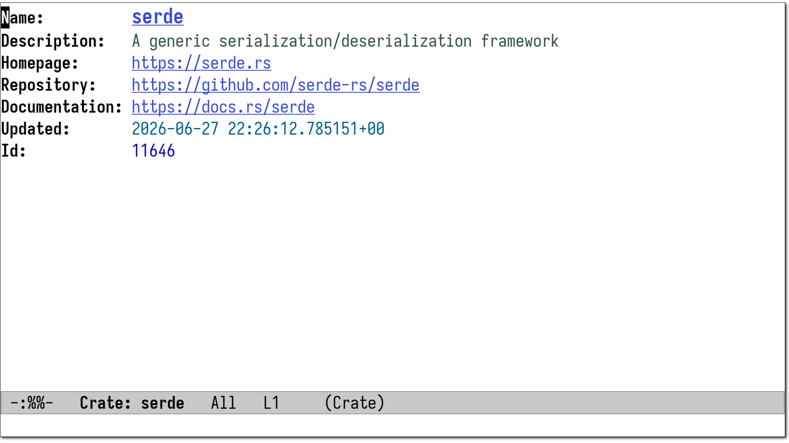

#+title: crate.el - Browse Rust crates in Emacs
#+author: Daniel Nagy
#+language: en

crate.el provides an interactive =completing-read= interface for
browsing Rust crates from a local crates.io SQLite database.
Optional on-demand rustdoc builds via Nix for module tree display.

* Features

- =M-x find-crate= with completion, Marginalia annotations, and Embark actions
- The homepage, repository and documentation URL of a detail buffer are
  clickable links, unless =crate-goto-address= is nil
- A refresh keeps point on the same field, dependency or module item,
  and every window that shows the buffer keeps its own line
- =TAB= folds the field block, the dependency and dependent lists, or
  the module tree of a detail buffer
- =M-x crate-browse-crates= tabulated list view with sorting and bookmarks
- The Version column sorts as semver (=1.9.0= before =1.10.0=, a
  pre-release before its release) and the columns fit the window;
  ={=/=}= resize one by hand
- Mouse support: the middle button opens a crate in another window,
  =mouse-3= opens a menu, one click only selects a row
- Export the visible rows as =Cargo.toml= dependency lines (=e c=)
  or as a Markdown table (=e m=)
- A table bookmark keeps the sort key and the column widths
- Redirect crates.io URLs to =find-crate= via =browse-url= handler
- Org link type: =crate:=
- Module tree display from rustdoc JSON (optional, requires Nix)
- Bookmark support for both detail and browse buffers

* Usage

Set =crate-data-path= to the location of your =crates-io.db= SQLite
database, then use =M-x find-crate= to look up a Rust crate.

To enable the browse URL handler:

#+begin_src elisp
  (crate-install-browse-url-handler)
#+end_src

* Crate details

=M-x find-crate= opens the detail buffer.  =TAB= folds or unfolds the
section around point: the field block, Dependencies, Dependents or
Modules, and a refresh keeps the folded sections.  A dependency name
and the URL fields are links, so =RET= on a dependency opens it and
=RET= on a URL opens the browser.  =w= copies a =Cargo.toml=
dependency line.

* Browse table

=M-x crate-browse-crates= opens the table.  =RET= opens the crate at
point, =o= and =mouse-2= open it in another window, =w= copies a
=Cargo.toml= dependency line, =b= opens crates.io, and =C-c C-o= opens
the crates.io page of the row at point from any cell.  =g= reloads the
table.  Click a column header to sort by it, and click again to
reverse the order.

The =e= prefix exports the visible rows: =e c= writes
=NAME = "VERSION"= lines for a =[dependencies]= section, and =e m=
writes a Markdown table.  An export follows the current sort and
the filter.

A narrow window shrinks the columns instead of pushing the
description off the screen.  A table larger than
=crate-browse-refit-max-entries= keeps its widths, because a reprint
of a full crates.io dump on every resize would stall.  Set =crate-display-buffer-action= to
=crate--other-window-action= to open every crate beside the buffer
that you started from.

* License

[[./LICENSE][AGPL3+]]
