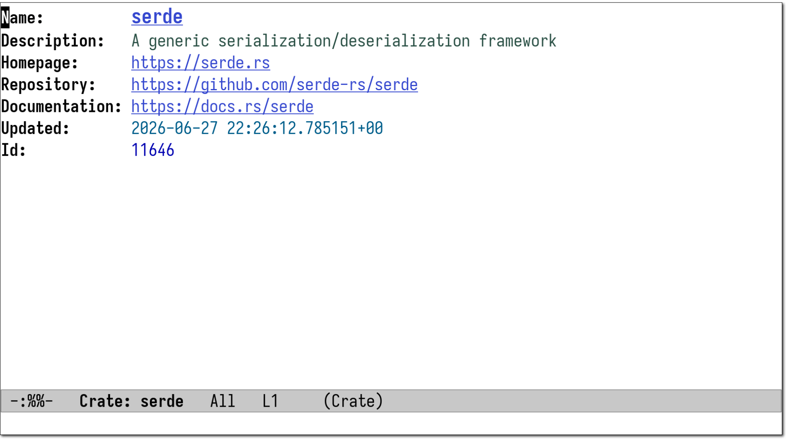

#+title: crate.el - Browse Rust crates in Emacs
#+author: Daniel Nagy
#+language: en

crate.el provides an interactive =completing-read= interface for
browsing Rust crates from a local crates.io SQLite database.
Optional on-demand rustdoc builds via Nix for module tree display.

* Features

- =M-x find-crate= with completion, Marginalia annotations, and Embark actions
- =M-x crate-visit-directory= shows a local crate from its
  =Cargo.toml=, with no database and no crates.io row
- The homepage, repository and documentation URL of a detail buffer are
  clickable links, unless =crate-goto-address= is nil
- The detail buffer is a tree of =magit-section= sections, so it folds,
  highlights and moves like a Magit buffer, and
  =crate-detail-sections-hook= decides which sections appear
- A refresh keeps point on the same line, and every window that shows
  the buffer keeps its own line
- =M-x crate-browse-crates= tabulated list view with sorting and bookmarks
- The Version column sorts as semver (=1.9.0= before =1.10.0=, a
  pre-release before its release) and the columns fit the window;
  ={=/=}= resize one by hand
- Mouse support: the middle button opens a crate in another window,
  =mouse-3= opens a menu, one click only selects a row
- Export the visible rows as =Cargo.toml= dependency lines (=e c=)
  or as a Markdown table (=e m=)
- A table bookmark keeps the sort key and the column widths
- Redirect crates.io URLs to =find-crate= via =browse-url= handler
- Org link type: =crate:=
- Optional Evil layer: motion, fold, copy and export keys in the table
  and the detail buffer
- Module tree display from rustdoc JSON (optional, requires Nix)
- =M-x crate-tree= shows the item structure of a crate as one
  collapsible table, the way =cargo-modules structure= prints it, with
  the span, the doc summary and the visibility of every item
- Bookmark support for both detail and browse buffers

* Usage

Set =crate-data-path= to the location of your =crates-io.db= SQLite
database, then use =M-x find-crate= to look up a Rust crate.

To enable the browse URL handler:

#+begin_src elisp
  (crate-install-browse-url-handler)
#+end_src

* Evil

With evil on the load path, =crate.el= loads =evil-crate.el= when evil
loads and enables =crate-evil-mode=.  No extra line is necessary.  To
keep the bindings off, set the option before evil loads:

#+begin_src elisp
  (setq crate-evil-auto-enable nil)
#+end_src

Every key that evil already binds goes through a key remap, so a user
who moves =evil-ret= to another key keeps the crate behavior on the new
key.  The evil motions stay untouched.

- In the table: =RET= opens the row, =o= opens it in another window,
  =c= opens crates.io, =y= and =Y= copy a dependency line, =S= sorts
  the column at point, =gc= and =gm= export the visible rows, =q=
  quits the window, =gr= refreshes and =r= or =R= refreshes without a
  confirmation.  A visual line selection followed by =y= copies one
  dependency line per selected row.
- In a detail buffer: =RET= opens the link at point, =TAB= folds the
  section at point, =c= opens crates.io, =y= and =Y= copy a dependency
  line, =q= quits the window, =gr= refreshes.  =zc=, =zo= and =za=
  fold the sections, because the buffer is a =magit-section= tree.

* Crate details

=M-x find-crate= opens the detail buffer.  The buffer is a tree of
=magit-section= sections, so it answers like a Magit buffer: =TAB=
folds or unfolds the section at point, =n= and =p= move between
sections, =^= goes to the parent section, and =1= to =4= show that many
levels.  Every module of the module tree is a section of its own.  A
refresh keeps the folded sections and the line of point.

`crate-detail-sections-hook' lists the functions that insert the
sections, in display order, and `crate-detail-fields' does the same for
the field lines.  Drop an entry to drop a section, or reorder the
entries to reorder them:

#+begin_src elisp
  (setopt crate-detail-sections-hook
          '(crate-insert-fields
            crate-insert-dependents
            crate-insert-dependencies))
#+end_src

A dependency name and the URL fields are links, so =RET= on a
dependency opens it and =RET= on a URL opens the browser.  =w= copies a
=Cargo.toml= dependency line.

* Local crates

=M-x crate-visit-directory= opens the crate of a local directory.  The
command prompts for a directory with ordinary file-name completion,
keeps only directories as candidates, and reads the crate fields and
the dependency list with =cargo metadata --no-deps --offline=.  So the
directory must hold a =Cargo.toml= and =crate-cargo-program= must name
a working cargo.  The default is =cargo=, which searches =PATH=, and
the Nix build writes the store path of its own cargo there, so an
installed package needs no cargo on =PATH=.  Set it to nil to turn the
command off.  The buffer is named =Crate: <name> (<path>)=, so a local
checkout and the published crate of the same name keep separate
buffers.  A virtual workspace root holds no package, so the command
prompts for one member and shows that member from its own directory.

Dependency rows read like the =Cargo.toml= lines that name them.  A
registry dependency shows =serde = "1.0"= and links to crates.io, a
path dependency shows =my-util = { path = "../my-util" }=, and a git
dependency shows its URL.  The Dependents section comes from the
database and stays empty for a crate that crates.io does not hold.  A
local crate shows no Modules section yet, because no rustdoc build
feeds it.  =g= reads the =Cargo.toml= again.

* Browse table

=M-x crate-browse-crates= opens the table.  =RET= opens the crate at
point, =o= and =mouse-2= open it in another window, =w= copies a
=Cargo.toml= dependency line, =b= opens crates.io, and =C-c C-o= opens
the crates.io page of the row at point from any cell.  =g= reloads the
table.  Click a column header to sort by it, and click again to
reverse the order.

The =e= prefix exports the visible rows: =e c= writes
=NAME = "VERSION"= lines for a =[dependencies]= section, and =e m=
writes a Markdown table.  An export follows the current sort and
the filter.

A narrow window shrinks the columns instead of pushing the
description off the screen.  A table larger than
=crate-browse-refit-max-entries= keeps its widths, because a reprint
of a full crates.io dump on every resize would stall.  Set =crate-display-buffer-action= to
=crate--other-window-action= to open every crate beside the buffer
that you started from.

* Crate tree

=M-x crate-tree= shows the item structure of a crate from the
database, and =M-x crate-tree-directory= shows the structure of a
local crate.  In a detail buffer, =S= or the =Structure= button opens
the same table, and =S= on a browse row opens the tree of that row.

The table holds one row per item: kind, name, visibility, file and
line, and the first sentence of the doc comment.  =TAB= folds a row,
the keys =1= to =9= set the depth, =s= cycles the sibling order
(source, name, kind, visibility), and =S= reverses it.  The =f=
prefix filters: =f p= shows public items only, =f k= chooses the item
kinds, =f f= keeps the subtree that a regexp matches, and =f r= drops
every filter.  =RET= opens the source of a local crate, =C-c C-o=
opens the docs.rs page, =y= copies the item path, =w= copies a
=Cargo.toml= line, and =g= rebuilds the document.

=C-x r m= saves the view as a bookmark, and the jump restores the
folds, the filters, the depth, the sort and the row at point.  A local
crate runs =cargo doc= with JSON output, which needs =cargo=,
=rustc= and the dependencies of the crate.  A database crate reads
the document from the Nix build that the detail buffer uses, so
=M-x crate-tree= follows =crate-doc-enable=.

A build that still runs reads =Rustdoc build in progress…=.  A build
that cannot start names the fix in place of the rows: the =Modules=
section reads =(rustdoc unavailable: REASON)= and the tree reads
=No rustdoc JSON: REASON=.  =crate-doc-nix-file= names the
=crate-doc.nix= file that =nix-build= runs, and the packaged build
fills in the store path of its own copy.  =g= drops the cached answer
and asks again, so a reader who fixes the reason retries from the
table.

* Development

The flake builds the package and runs every check:

#+begin_src sh
  nix build        # the package at result/
  nix flake check  # build, both ERT suites and the lint gate
#+end_src

The ERT suites live in =test/=, one file per source unit, named
=<unit>-test.el=.  Shared fixtures live in =test/crate-test-helper.el=,
and the Nix checkPhase loads the suites through a =test/*-test.el= glob.
Run one suite in a plain shell with:

#+begin_src sh
  emacs --batch -L . -L test -l test/crate-test.el \
    -f ert-run-tests-batch-and-exit
#+end_src

=checks.lint= runs checkdoc and package-lint over the package files and
the test files, so a docstring or header problem fails =nix flake check=.
The package version is =0.1.0-unstable-<commit date>=, derived from the
flake source info.

* License

[[./LICENSE][AGPL3+]]
